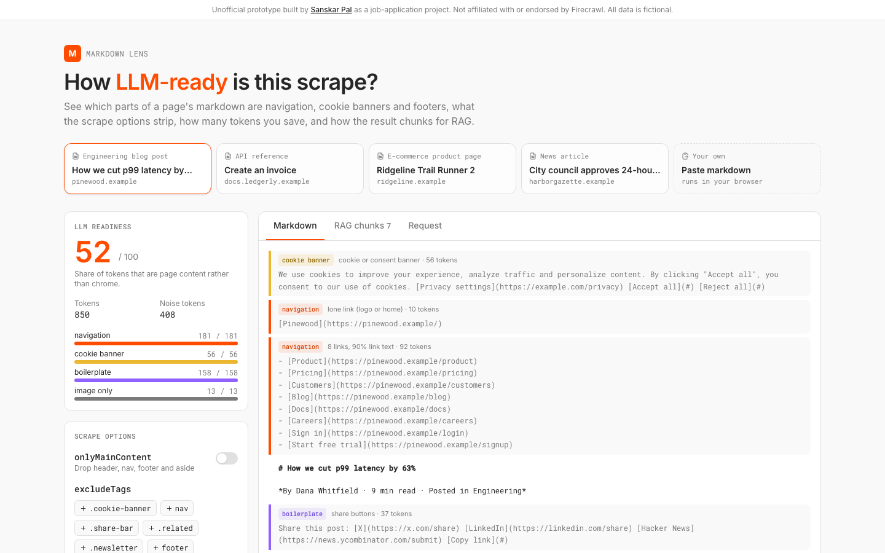

# Markdown Lens

How LLM-ready is this scrape? See which parts of a page's markdown are navigation, cookie banners and footers, what the scrape options strip, how many tokens you save, and how the result chunks for RAG. An unofficial prototype for Firecrawl, built by Sanskar Pal while applying for the Product Engineer, Scrape role.

**Live demo:** _coming soon_ · **Stack:** React 19, TypeScript, Tailwind v4, Vitest



## Why

Firecrawl's promise is that one call turns any URL into clean, LLM-ready markdown. The [Scrape posting](https://jobs.ashbyhq.com/firecrawl/83249105-3b1e-41fc-a991-4fd41670ffca) asks for someone who cares about developer experience "like a designer cares about pixels" and turns hard problems into clean APIs. The [scrape docs](https://docs.firecrawl.dev/features/scrape) expose `onlyMainContent`, `includeTags` and `excludeTags`, but it's hard to *see* what they do to your token bill and your retrieval quality before you write code. This is a small tool for that moment.

## What it does

- **Noise detection on any markdown.** Blocks are labeled navigation, cookie banner, boilerplate (footers, share bars, newsletter prompts, ads, promo bars) or image-only, with the reason ("8 links, 90% link text"). Paste your own markdown to try it.
- **LLM readiness score**: the share of tokens that are page content, with a per-kind breakdown.
- **Option preview** on four sample pages (blog post, API docs, product page, news article): toggle `onlyMainContent` and click suggested `excludeTags` selectors to see what disappears and the tokens saved. The blog post goes from 52 to 97.
- **RAG chunks**: heading-aware chunking with a token budget. Chunks never cross a heading, carry their heading path, and keep code blocks whole.
- **Request builder**: the `POST /v2/scrape` call for the current options in cURL, JavaScript and Python.

## How it works

- [src/lib/blocks.ts](src/lib/blocks.ts): splits markdown into blocks (fenced code and tables stay whole) and classifies each with link density, pattern rules and length guards; computes readiness.
- [src/lib/simulate.ts](src/lib/simulate.ts): sample pages are annotated with the element each section came from (`nav`, `div.cookie-banner`, `aside.related`…). The simulator applies `onlyMainContent` (drops header/nav/footer/aside) and `excludeTags` (tag, `.class`, `#id`, `tag.class` selectors). It's a local approximation to make the options tangible, not Firecrawl's extractor.
- [src/lib/chunk.ts](src/lib/chunk.ts): heading-path tracking, greedy packing to the budget, sentence-boundary splits for long prose.
- [src/lib/request.ts](src/lib/request.ts): request body and code generators.

24 tests (`npm test`): block splitting, every classifier rule, readiness math, option simulation, selector matching, chunking invariants and the generated code (the cURL body parses back to the same JSON).

## Tradeoffs and what I'd do next

- Token counts are estimated at ~4 characters per token; a real version would use the target model's tokenizer.
- Noise detection is heuristic. With access to the raw HTML, the same view could be driven by Firecrawl's real output and diff `onlyMainContent` on vs off.
- Next: a live mode that calls the API with the user's key from a server route (never the browser), a "suggest excludeTags" button that proposes selectors from detected noise, and a side-by-side of retrieval results with and without the cleanup.

## Run locally

```bash
npm install
npm run dev
npm test
```

---

Not affiliated with or endorsed by Firecrawl. The sample sites and their content are fictional.
